# Setting up NotePilot's AI

NotePilot needs an AI model to organize your notes. Pick **one** option below. You can switch at any time in **Settings → AI model**.

## Which one should I pick?

| Option | Cost | Where your notes go | Account needed | Quality |
|---|---|---|---|---|
| [Groq](#1-groq-free-tier) | Free (about 40–60 updates a day) | Groq | Yes, 18+ | Very good |
| [Google Gemini](#2-google-gemini-free-tier) | Free (limits per model) | Google, **may be used for training** | Yes, 18+ | Very good |
| [Mistral](#3-mistral-free-mode) | Free (small monthly allowance) | Mistral, may be used for training unless you opt out | Yes, 18+ | Good |
| [OpenRouter free models](#4-openrouter-free-models) | Free (50 requests a day) | Depends on the model | Yes, 18+ | Varies |
| [OpenAI or Anthropic](#5-openai-or-anthropic-paid) | A few cents a day | OpenAI or Anthropic | Yes, with billing | Best |
| [NotePilot server](#6-a-notepilot-server-school-or-team) | Paid by whoever runs it | That server | An access token | Best |

**Quick pick:**
- Best free option → **Groq**.
- Best results → **OpenAI** or **Anthropic** (a few cents a day).
- Your school or team gave you a server address → **NotePilot server**.
- Under 18 → the free tiers' terms require users to be 18 or older. Ask your school whether it provides a NotePilot server.

NotePilot can also run a model on your own computer, but it organizes notes less well and slows the computer down; see [Models on your own computer](#models-on-your-own-computer-not-recommended) at the end.

Follow your school's or workplace's rules on which AI tools may see your notes.

---

## Before you start

1. Open a Google Doc and click the **NotePilot** icon in Chrome's toolbar (or press **Alt+Shift+N**).
2. The first time, the panel walks you through three steps. Step 2, **Connect an AI model**, is where the options below go. Later, the same form is in **Settings → AI model**.

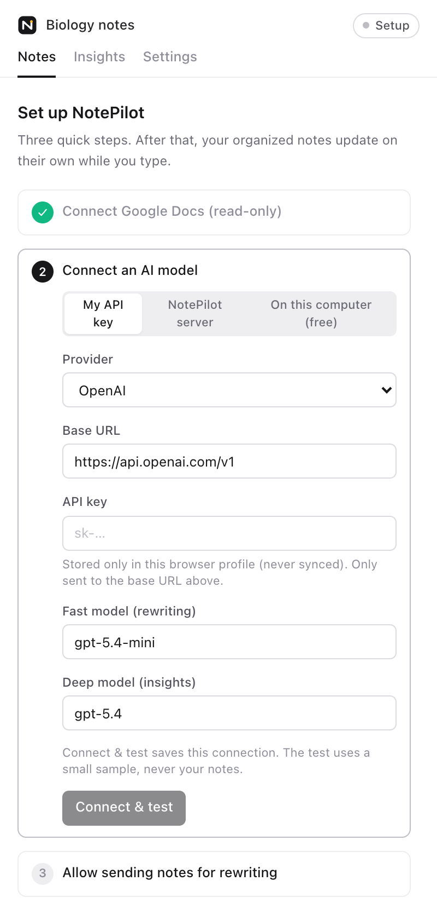

3. Every option ends with **Connect & test**. It sends a tiny sample (never your notes) and shows a green **Connected** when it works.
4. The first time Chrome needs to reach a new service, it asks you to allow NotePilot to *read and change your data* on that site. Click **Allow**: it's how NotePilot is allowed to talk to that one address.
5. Last step: NotePilot tells you where your notes will be sent. Click **Allow and start organizing**.

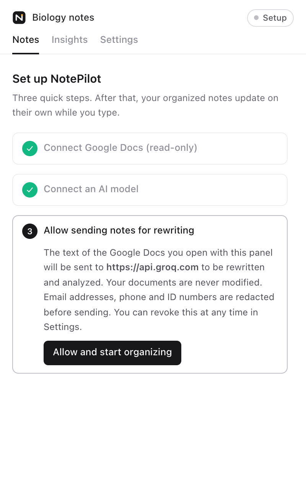

---

## 1. Groq (free tier)

Very good quality and fast, for free. The free tier allows about 200,000 tokens a day, roughly 40–60 updates of your notes. Groq doesn't train on what you send. You must be 18 or older.

1. Go to [console.groq.com](https://console.groq.com) and sign up.
2. Open [**API Keys**](https://console.groq.com/keys) → **Create API Key**, name it *NotePilot*, and copy the key. It's only shown once.
3. In **AI model**, choose **My API key**, then **Provider → Groq (free tier)**. Paste the key into **API key** and click **Connect & test**. Allow Chrome to reach `api.groq.com` when it asks.

   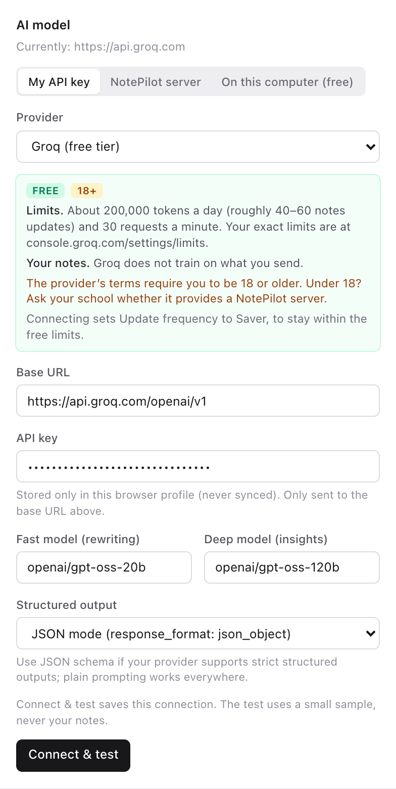

Connecting sets **Update frequency** to **Saver** (Settings → Processing), which keeps you within the free limit. Your exact limits are at [console.groq.com/settings/limits](https://console.groq.com/settings/limits).

---

## 2. Google Gemini (free tier)

Very good quality, free. **On the free tier, Google may use what you send to improve its models, and people may read it.** Don't use it for personal or confidential notes. You must be 18 or older.

1. Go to [aistudio.google.com/apikey](https://aistudio.google.com/apikey) and sign in with a Google account.
2. Click **Create API key** and copy it.
3. In **AI model**, choose **My API key**, then **Provider → Google Gemini (free tier)**. Paste the key and click **Connect & test**.

   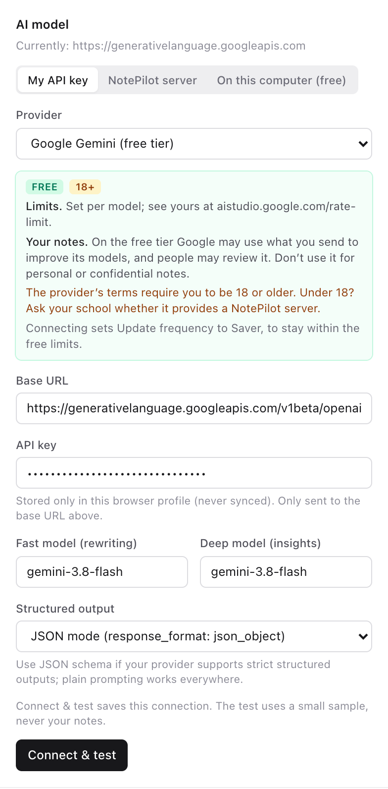

Your limits are at [aistudio.google.com/rate-limit](https://aistudio.google.com/rate-limit). Gemini can't transcribe recordings; see [Recording](#recording-lectures) for a free option.

---

## 3. Mistral (free mode)

Good quality, with a small free monthly allowance. Mistral may train on free-mode data unless you turn that off in its privacy settings. You must be 18 or older.

1. Go to [console.mistral.ai](https://console.mistral.ai), sign up, and choose the free plan when asked.
2. Open **API keys** → **Create new key**, and copy it.
3. Optional: in Mistral's admin settings, under **Privacy**, turn off training on your data.
4. In **AI model**, choose **My API key**, then **Provider → Mistral (free mode)**. Paste the key and click **Connect & test**.

   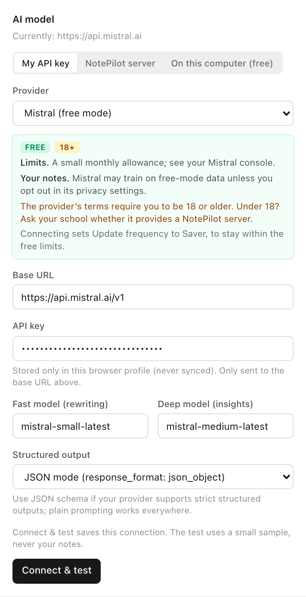

---

## 4. OpenRouter (free models)

One account for many models, including free ones. You get 50 free requests a day, or 1,000 after a one-time $10 credit purchase. Free models come and go, so you choose one yourself. You must be 18 or older.

1. Go to [openrouter.ai](https://openrouter.ai), sign in, open [**Keys**](https://openrouter.ai/keys) → **Create key**, and copy it.
2. Find a free model at [openrouter.ai/models?max_price=0](https://openrouter.ai/models?max_price=0) and copy its name, which ends in `:free`.
3. In **AI model**, choose **My API key**, then **Provider → OpenRouter (free models)**. Paste the key, paste the model name into **both** model fields, and click **Connect & test**.

   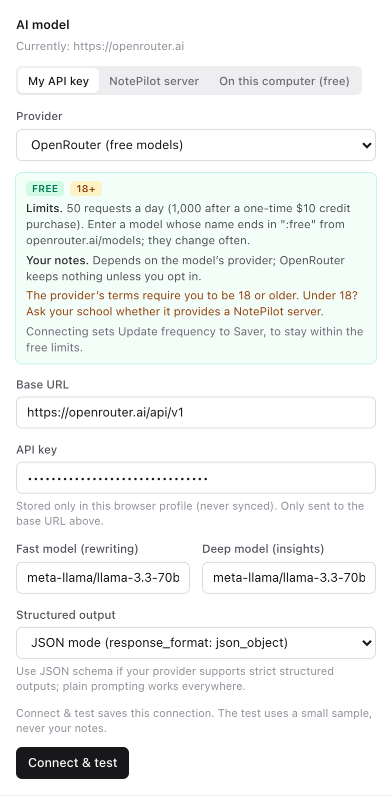

What happens to your notes depends on the model's provider; OpenRouter shows this on each model's page.

---

## 5. OpenAI or Anthropic (paid)

The best quality. Typical use costs a few cents a day.

- **OpenAI:** create a key at [platform.openai.com/api-keys](https://platform.openai.com/api-keys) and add a payment method under **Billing**. Then choose **Provider → OpenAI, low cost (GPT-6 Luna)** (cheapest) or **OpenAI**.
- **Anthropic:** create a key at [platform.claude.com/settings/keys](https://platform.claude.com/settings/keys) and add billing. Then choose **Provider → Anthropic, low cost (Claude Haiku 5.5)**.

Paste the key and click **Connect & test**.

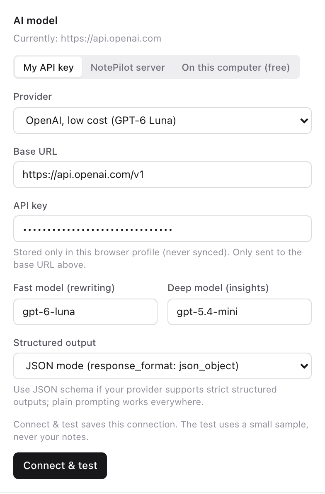

Set a daily spending limit in **Settings → Cost limits**. NotePilot stops sending once you reach it.

---

## 6. A NotePilot server (school or team)

If your school or team runs a NotePilot server, they hold the AI key and give you an address and a personal access token.

1. In **AI model**, click **NotePilot server**.
2. Enter the **Server URL** and **Access token** they gave you, and click **Connect & test**.

   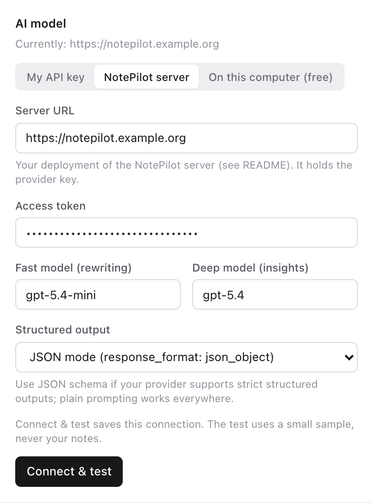

---

## Recording lectures

**Record** (in the Notes toolbar) needs a speech-to-text service. Choose it in **Settings → Recording → Transcription**:

| Transcription | Cost | Notes |
|---|---|---|
| **Same as AI connection** | Your provider's price | Works when your AI connection is OpenAI, Groq or Mistral. With any other option, choose one below. |
| **Groq (free tier)** | Free, about 8 hours of audio a day | Needs a Groq key (step 2 of [Groq](#1-groq-free-tier)). 18+. |
| **OpenAI** / **Mistral (Voxtral Mini)** | About $0.003 a minute | Needs a key from that provider. |

**Groq:** choose **Groq (free tier)** and paste your Groq key into **Transcription API key**. It can be the same key you use for notes.

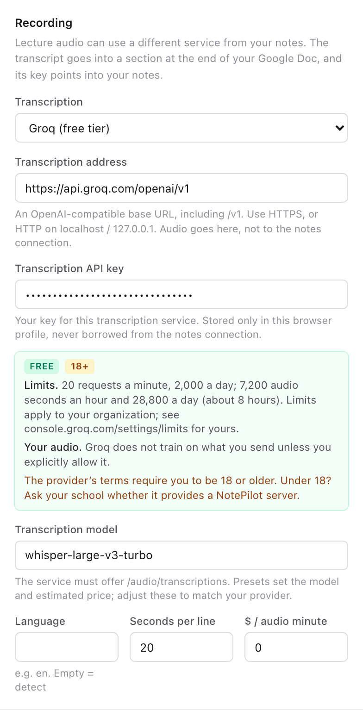

**Set your microphone volume first.** When you record with the microphone, NotePilot reminds you to check the input volume and shows a live **Input level** bar. The bar should move whenever the speaker talks; if it barely moves, turn the input volume up (on a Mac: System Settings → Sound → Input; on Windows: Settings → System → Sound → Input) or sit closer. If nothing is heard for about 40 seconds, NotePilot warns you.

The first time you record, NotePilot shows where the audio will be sent and asks you to confirm. Only record people who agree to it, and follow your school's rules on recordings.

---

## Models on your own computer (not recommended)

NotePilot can use a model that runs on your own computer instead of a cloud service. It's free and nothing leaves the computer, but **we don't recommend it for most people**:

- **Weaker results.** Small local models organize notes noticeably less well, and Chrome's built-in model often leaves notes under *Not Yet Organized*.
- **Slow.** Each update can take tens of seconds on a typical laptop.
- **Heavy.** They need several GB of disk, and several GB of memory while running, which slows down everything else.

Use one only if you can't use any of the options above.

### Chrome's built-in AI ("On this computer")

Free and private, but the least capable option: it often leaves notes unorganized, and it can't transcribe recordings.

**You need:** Chrome on Windows 10/11, macOS 13+, Linux or a Chromebook Plus; **22 GB of free disk space** for a one-time download; and a graphics chip with more than 4 GB of memory, or 16 GB of RAM.

1. In **AI model**, click **On this computer (free)**.
2. If it says *The local model needs a one-time download*, click **Download the model** and keep the panel open. It's a few GB.

   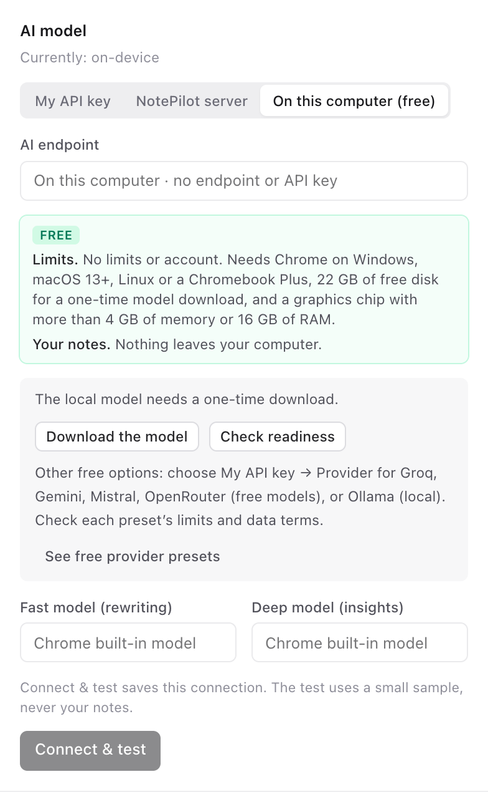

3. When it says **Local model ready on this computer**, click **Connect & test**.

   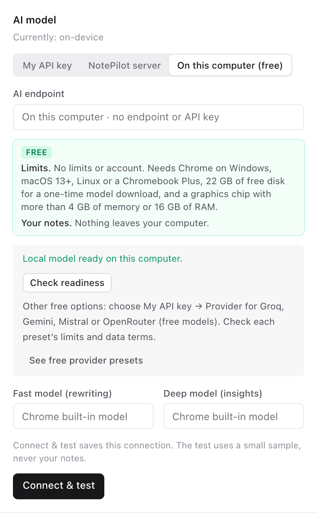

**If the download doesn't move:** Chrome only downloads the model when the disk has at least 22 GB free, and it removes the model again if free space drops below 10 GB. Free up space, quit and reopen Chrome, and open `chrome://on-device-internals` to see why Chrome is waiting.

### Ollama

Free and private, but slower and less accurate than the cloud options, and it takes about 10 minutes of technical setup. While it runs it uses several GB of memory, which slows down the rest of the computer; quit it when you're not taking notes.

**You need:** about 5 GB of free disk and at least 8 GB of memory (16 GB is smoother).

1. **Install Ollama.** Download it from [ollama.com/download](https://ollama.com/download), open the file, and move **Ollama** to Applications (on Windows, run the installer). Open it: a llama icon appears in the menu bar (Windows: the taskbar).
2. **Let NotePilot reach Ollama.** Ollama only answers apps it trusts, so tell it to trust Chrome extensions:
   - **Mac:** open **Terminal** (Applications → Utilities), paste this line and press Return:

     ```bash
     launchctl setenv OLLAMA_ORIGINS "chrome-extension://*"
     ```

     Then quit Ollama (click the llama icon → **Quit Ollama**) and open it again. After restarting your Mac, run the line again before opening Ollama.
   - **Windows:** quit Ollama from the taskbar. Open **Settings**, search for *environment variables*, click **Edit environment variables for your account**, and add a new variable named `OLLAMA_ORIGINS` with the value `chrome-extension://*`. Click **OK**, then start Ollama from the Start menu.
   - **Linux:** run `sudo systemctl edit ollama.service`, add the two lines `[Service]` and `Environment="OLLAMA_ORIGINS=chrome-extension://*"`, save, then run `sudo systemctl restart ollama`.
3. **Download the model** (3.4 GB). In Terminal:

   ```bash
   ollama pull gemma3:4b
   ```

   If the Mac says *command not found*, use `/Applications/Ollama.app/Contents/Resources/ollama pull gemma3:4b` instead.
4. **Connect.** In **AI model**, choose **My API key**, then **Provider → Ollama (local)**. Leave **API key** empty and click **Connect & test**.

   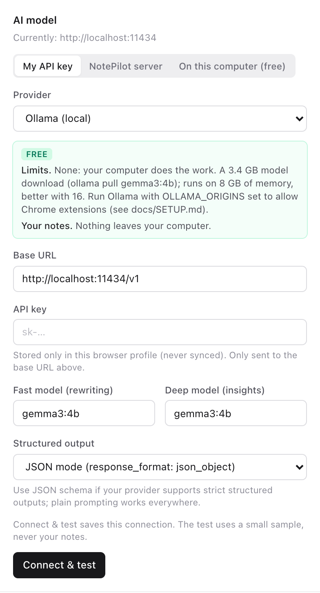

`gemma3:4b` is the default because it was the fastest model that fits in 8 GB of memory in our tests.

### Local Whisper (recording)

Records without sending audio anywhere, but needs a technical setup and memory while it runs. Install [Speaches](https://speaches.ai/installation/), start it, and download its model once:

```bash
uvx speaches-cli model download Systran/faster-whisper-small
```

Then choose **Local Whisper (free, private)**. No key is needed.

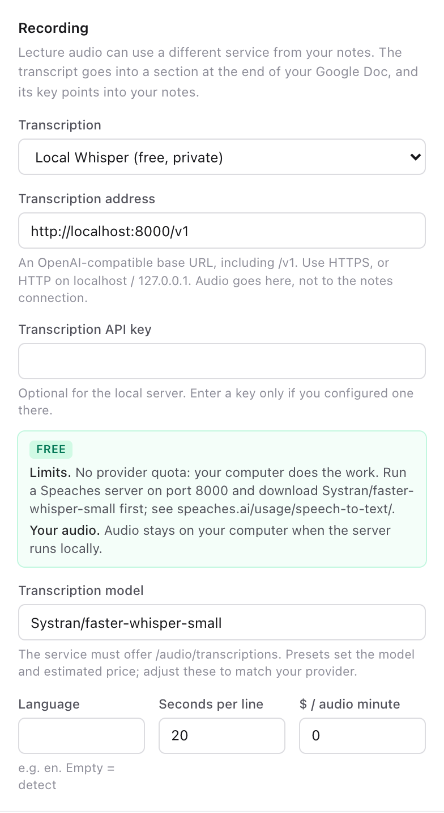

---

## Troubleshooting

| You see | What to do |
|---|---|
| *Chrome permission to contact … was not granted* | Click **Connect & test** again and choose **Allow** in Chrome's prompt. |
| *The AI provider rejected the API key* | Copy the key again; it may be incomplete or deleted. Make sure it's for the provider you chose. |
| *AI rate limit reached* | You've hit a free tier's limit. NotePilot retries later. Keep **Update frequency** on **Saver**. |
| Notes stay under *Not Yet Organized* | The model's answer couldn't be used. NotePilot tries again about a minute after you stop typing. If it keeps happening, choose a stronger option. |
| Ollama: *Failed to fetch* or *AI provider unreachable* | Ollama isn't running. Open it, and keep it open while you take notes. |
| Ollama: *rejected the API key* (there is no key) | Ollama doesn't trust Chrome extensions yet. Redo step 2 of [Ollama](#ollama), then quit and reopen Ollama. |
| This computer: the download stays at 0% | Free up space until at least 22 GB is free, restart Chrome, and check `chrome://on-device-internals`. |
